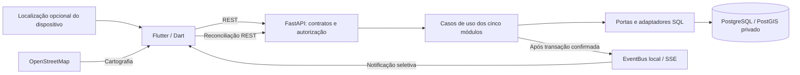

# NightPoint

**Aplicativo de Mobilidade Urbana — Processamento em Tempo Real**


| Informação acadêmica | Identificação |
|---|---|
| Instituição | Uni-FACEF |
| Disciplina | Arquitetura de Software |
| Professor | Carlos Alberto Lucas |
| Semestre | 6º semestre |

## Apresentação

O NightPoint é um protótipo acadêmico para descoberta e organização de encontros automotivos por região. Integra uma interface Flutter, uma API FastAPI e consultas geoespaciais em PostgreSQL/PostGIS, com atualização seletiva de dados por Server-Sent Events (SSE).

O projeto demonstra decisões arquiteturais em uma aplicação executável. Encontros, perfis e veículos de demonstração são fictícios; não representam convites para eventos reais ou orientação de trânsito.

## Problema

Informações sobre encontros automotivos podem ficar dispersas, dificultando a descoberta de atividades próximas e o acompanhamento de alterações. O NightPoint reúne consulta por região, gestão de encontros e interações entre participantes. A localização opcional do dispositivo e o mapa apoiam a exploração urbana.

## Objetivo acadêmico

Aplicar e analisar coesão, acoplamento e conascência, demonstrando a separação de responsabilidades entre interface, regras de negócio e persistência. O recorte permite discutir os benefícios e os custos de um monólito modular com arquitetura em camadas, portas e adaptadores e injeção de dependências.

## Funcionalidades implementadas

- Autenticação acadêmica com duas personas e edição de perfil privado.
- Cinco abas: Início, Mapa, Eventos, Social e Perfil; temas claro, escuro e automático.
- Mapa OpenStreetMap com navegação, seleção de ponto, marcadores e acesso ao detalhe do encontro.
- Busca de encontros por região e distância, com alternativa manual à geolocalização.
- Criação, listagem própria, edição e cancelamento lógico de encontros, com controle de versão.
- Atualização seletiva de detalhes por SSE, seguida de reconciliação REST.
- Curtidas, participações, comentários e retirada/restauração autorizadas.
- Garagem privada com múltiplos veículos, principal opcional único, edição, arquivo, restauração e histórico.

A integração de geolocalização está implementada, mas a obtenção de uma posição GPS real **não foi confirmada no navegador da demonstração**.

## Tecnologias utilizadas

| Camada | Tecnologias e finalidade |
|---|---|
| Frontend | Flutter e Dart para interface, estado de apresentação e comunicação com a API |
| Backend | Python e FastAPI para contratos HTTP, autenticação, autorização e casos de uso |
| Persistência | PostgreSQL para transações e integridade; PostGIS para consultas geoespaciais |
| Comunicação | REST para operações e consultas; SSE para notificações seletivas |
| Mapa e localização | OpenStreetMap, flutter_map, latlong2 e geolocator |
| Ambiente local | Docker e Docker Compose para API e banco isolados |

## Arquitetura de software

A solução é um **monólito modular**, com cinco módulos de negócio:

| Módulo | Responsabilidade |
|---|---|
| Identity | Identidade e perfil privado |
| Events | Gestão, autoria, visibilidade e versionamento de encontros |
| Discovery | Busca regional e projeção autorizada de encontros |
| Garage | Veículos privados, principal e histórico |
| Community | Reações, participações e comentários |

A plataforma fornece banco, configuração e comunicação de eventos. As camadas de apresentação, aplicação, domínio e infraestrutura têm responsabilidades distintas. Portas e adaptadores isolam integrações relevantes; a composição injeta as implementações. O frontend acessa a API, sem conexão direta com tabelas de negócio. O backend autoriza os recursos e mantém a persistência privada.



### Coesão, acoplamento e conascência

A coesão é promovida pelo agrupamento das regras por capacidade de negócio. O acoplamento é controlado por contratos públicos, repositories e portas, mantendo a injeção de dependências na composição. O compartilhamento de processo e banco continua sendo uma dependência operacional assumida.

Os seis exemplos de conascência analisados na implementação são:

| Tipo | Exemplo concreto | Tratamento |
|---|---|---|
| Nome | Campos JSON `starts_at` e `version` entre API e Dart | Contrato concentrado em DTOs e repositories |
| Tipo | Versão inteira do encontro no backend e no frontend | Tipagem explícita e verificação do contrato |
| Significado/convenção | Valores de visibilidade `listed` e `owner_only` | Política de autorização centralizada no servidor |
| Posição | Ordem latitude/longitude em `DevicePoint` e `LatLng` | Dependência localizada nos adaptadores e no modelo de mapa |
| Execução | Confirmação da transação antes de publicar a invalidação | Ordem preservada dentro do caso de uso |
| Temporal | Transações simultâneas escolhendo o veículo principal | Bloqueio transacional por proprietário e índice único parcial |

A classificação temporal trata de concorrência; não decorre apenas da expressão “tempo real”. A [análise arquitetural](docs/ARCHITECTURE.md) relaciona os exemplos aos arquivos e explicita os impactos de mudança.

## Estrutura dos diretórios

```text
backend/
  app/modules/       cinco módulos de negócio
  app/platform/      serviços de infraestrutura compartilhados
  migrations/        evolução do esquema e permissões
  tests/             testes do backend e das fronteiras arquiteturais
contracts/           contratos OpenAPI
nightpoint/
  lib/app/           composição do aplicativo
  lib/core/          comunicação, tema e localização
  lib/features/      capacidades do frontend
  test/              testes Flutter
  web/               recursos da versão Web
infra/               ambiente Docker, inicialização e dados fictícios
scripts/             execução e verificação da demonstração
docs/                arquitetura, operação, provedores e evidências
```

## Mapa, GPS, PostGIS, REST e SSE

O mapa utiliza cartografia OpenStreetMap com atribuição visível. O usuário pode selecionar um ponto ou informar a região manualmente. A geolocalização solicita permissão explícita e atualiza o marcador local enquanto a tela está ativa; não armazena trajetórias nem envia continuamente cada posição ao servidor.

A busca envia seu centro à API por REST. O backend valida a região e a autorização; o PostGIS filtra os encontros por distância geográfica. Os marcadores permitem abrir os detalhes dos encontros retornados.

Após uma alteração confirmada em transação, o backend envia uma notificação SSE aos clientes conectados ao encontro. O consumidor consulta novamente o recurso por REST, reconciliando o estado autorizado. Esse fluxo foi validado com duas sessões reais. O EventBus é local a um processo; não há garantia de entrega distribuída ou tempo real rígido.

## Pré-requisitos

- Git e Python 3.13.
- Flutter com suporte Web e Dart compatível com `sdk: ^3.12.0`.
- Docker Desktop com Docker Compose disponível e em execução.
- Navegador e conexão à Internet para dependências, imagens e cartografia.
- Para geolocalização: contexto seguro (localhost ou HTTPS), suporte do dispositivo e permissão do navegador.

## Instalação e execução

Os comandos abaixo usam PowerShell. No Linux/macOS, crie o ambiente com `python3.13 -m venv .venv` e utilize `.venv/bin/python` no lugar de `.venv\Scripts\python.exe`.

### 1. Obter o projeto e instalar as dependências

```powershell
git clone https://github.com/PatrickSoaresVitor/nightpointv2.git
Set-Location nightpointv2
py -3.13 -m venv .venv
Push-Location nightpoint
flutter pub get
Pop-Location
```

### 2. Iniciar a API e o banco

```powershell
.venv\Scripts\python.exe scripts/start_demo.py
```

O script prepara um ambiente isolado, aplica as migrations e cria perfis, três encontros e três veículos fictícios pela API. A API usa uma porta local disponível; o banco permanece sem porta publicada. As credenciais são geradas localmente e ficam fora do Git. A demonstração usa autenticação sintética, sem exigir credenciais pessoais ou Firebase real.

### 3. Executar o frontend Web

Em outro terminal, na raiz do repositório:

```powershell
$demo = Get-Content .artifacts/academic/current-demo.json -Raw | ConvertFrom-Json
Push-Location nightpoint
flutter run -d web-server --web-hostname 127.0.0.1 --web-port 5174 --target lib/main.dart --dart-define=NP_SYNTHETIC=true "--dart-define=NP_API_URL=$($demo.api_url)"
Pop-Location
```

Abra [http://127.0.0.1:5174/](http://127.0.0.1:5174/). Use apenas um servidor nessa porta.

### Alternativa: gerar e servir o artefato Web

Após instalar as dependências e iniciar a API, execute na raiz, em vez de `flutter run`:

```powershell
.venv\Scripts\python.exe scripts/build_web.py
.venv\Scripts\python.exe -m http.server 5174 --bind 127.0.0.1 --directory nightpoint/build/web
```

O build não é versionado e deve preservar `assets/NOTICES`. Para encerramento, recuperação de ambiente ou verificações opcionais, consulte [Operação local](docs/OPERACAO-LOCAL.md).

## Roteiro de demonstração

1. Entrar como **Organizador Demo** e apresentar as cinco abas.
2. Abrir **Mapa**, observar a cartografia, a atribuição e os encontros fictícios na região de Franca.
3. Buscar a região, selecionar um marcador e abrir o detalhe retornado pela API/PostGIS.
4. Solicitar a localização, se desejado. Caso não haja posição disponível, demonstrar a seleção manual; não apresentar a ausência de fix como GPS validado.
5. Em duas sessões independentes da mesma persona, abrir um encontro e editar seus dados; observar a atualização do detalhe por SSE e REST.
6. Demonstrar interações sociais e a garagem privada, incluindo o veículo principal e seu histórico.
7. Sair e entrar como **Piloto Demo**, mostrando a separação dos dados privados entre personas.

O roteiro orienta a apresentação; não representa aprovação automatizada de todas essas jornadas na execução acadêmica.

## Testes e evidências

Os resultados abaixo foram registrados anteriormente. Esta revisão documental não executa novos testes, benchmarks ou builds.

| Verificação registrada | Resultado e alcance |
|---|---|
| Análise Flutter completa | Nenhum problema identificado |
| Testes Flutter direcionados | 17 aprovados, com dispositivos e HTTP controlados |
| Fronteiras arquiteturais | Grafo de 51 nós Python acíclico e ownership válido |
| API/PostGIS | Três encontros próximos, região distante vazia e acesso cruzado ao veículo privado negado com HTTP 404 |
| SSE e REST | Duas sessões reais, frame `changed` e reconciliação com versão confirmada |
| Navegador | Cartografia, três marcadores, detalhe e busca manual confirmados |
| GPS real no navegador | Obtenção de posição não confirmada |
| Artefato Web | Build concluído anteriormente e servido com HTTP 200; atribuições preservadas |

Também foram registradas falhas no bootstrap inicial e timeouts em duas construções, seguidos de recuperação do mesmo volume. Na operação funcional anterior, uma rodada conjunta teve quatro aprovações e quatro falhas ou timeouts. Os testes direcionados desta entrega não substituem a aprovação integral dessa rodada.

Os [registros de evidências](docs/EVIDENCIAS.md), [resumos e hashes](docs/EVIDENCIAS.json) e o [relatório de entrega](RELATORIO-ENTREGA-ACADEMICA.md) detalham resultados e limitações. Logs brutos e recibos privados não integram o repositório público.

## Limitações conhecidas

- Protótipo local com autenticação sintética; identidade real, idade, MFA e recuperação de acesso não validados.
- GPS dependente do navegador e do dispositivo, sem posição real confirmada na demonstração; alternativa manual disponível.
- Cartografia dependente da Internet e do provedor; sem download offline ou garantia de disponibilidade.
- SSE restrito a um processo, sem garantia distribuída, latência rígida ou desempenho de produção comprovado.
- Preferência de tema mantida em memória.
- Rotas, geocodificação avançada e APK/Android validado fora desta entrega.
- Suíte geral, auditoria global de segurança e aptidão para produção não aprovadas por esta entrega.

## Integrantes

- João Vitor Dias Oliveira.
- Pablo Vinicius Soares Vitor.
- Patrick Soares Vitor.

A autoria do código de origem e as atribuições de terceiros estão preservadas em [Autoria e atribuições](ATTRIBUTIONS.md) e na [proveniência](ACADEMIC-PROVENANCE.json). Não foi concedida uma nova licença geral ao código autoral. As dependências mantêm suas licenças; a cartografia exige atribuição a © OpenStreetMap contributors. As regras acadêmicas de declaração de autoria e ferramentas continuam aplicáveis.

## Referências bibliográficas

- RICHARDS, Mark; FORD, Neal. *Fundamentos da Arquitetura de Software*. Edição em português adotada na disciplina; referência para modularidade, coesão, acoplamento e conascência. Os dados específicos de edição e paginação não constam neste pacote.
- RICHARDS, Mark; FORD, Neal. *Fundamentals of Software Architecture: An Engineering Approach*. O’Reilly, 2020. [Capítulo sobre modularidade](https://www.oreilly.com/library/view/fundamentals-of-software/9781492043447/ch03.html), como consulta complementar ao original em inglês.
- CONNASCENCE.IO. [Taxonomia de conascência](https://connascence.io/).
- OPENSTREETMAP FOUNDATION. [Direitos e atribuição](https://www.openstreetmap.org/copyright) e [política de uso de tiles](https://operations.osmfoundation.org/policies/tiles/).

As classificações e os exemplos aplicados ao código são análise deste projeto, sem reprodução de trechos do livro. Consulte também a documentação de [cartografia e privacidade](docs/PROVEDORES.md).
