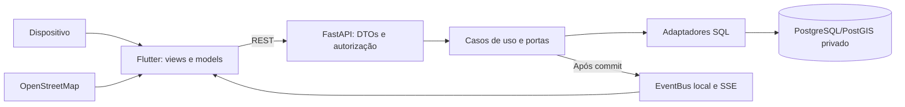

# NightPoint — versão acadêmica (nightpointv2)

Protótipo executável de **Aplicativo de Mobilidade Urbana — Processamento em Tempo Real**, para a disciplina Arquitetura de Software do Uni-FACEF, professor Carlos Alberto Lucas. O foco é demonstrar módulos coesos, acoplamento controlado, conascência e decisões arquiteturais; não é um produto comercial completo.

## Problema e relação com mobilidade

O NightPoint auxilia entusiastas a descobrir encontros automotivos por região. A posição opcional do dispositivo e a cartografia apoiam a exploração urbana; a API valida o ponto e o PostGIS filtra encontros por distância. Os encontros, perfis e veículos do protótipo são **fictícios**. Não são convites para eventos reais nem orientação de trânsito.

## Funcionalidades

- Autenticação acadêmica com duas personas e perfil privado editável.
- Cinco abas: Início, Mapa, Eventos, Social e Perfil; temas claro/escuro/automático.
- Cartografia OpenStreetMap, pan/zoom, posição atual mediante permissão, centralização, seleção por clique e alternativa manual.
- Busca geoespacial pela API; marcadores autorizados e abertura do detalhe.
- Criação, listagem própria, edição e cancelamento lógico de encontros, com controle de versão.
- Atualização seletiva por SSE e reconciliação REST.
- Curtidas, participações, comentários e retirada/restauração autorizadas.
- Garagem privada com múltiplos veículos, principal opcional único, edição, arquivo/restauração e histórico.

## Processamento em tempo real

A geolocalização atualiza o marcador local enquanto a tela está ativa. Não armazena trajetórias e não envia continuamente cada posição à API. Buscar encontros envia o centro da busca; o backend aplica validação, autorização e distância geográfica no PostGIS.

SSE é outro fluxo: após uma alteração **confirmada em transação**, o servidor notifica clientes conectados ao encontro. O consumidor relê o estado REST autorizado. Duas sessões independentes podem editar/observar o mesmo encontro. REST comum não é apresentado como comunicação contínua. O protótipo não garante tempo real rígido, entrega distribuída ou desempenho de produção.

## Tecnologias, módulos e arquitetura

Flutter/Dart → REST/SSE FastAPI/Python → PostgreSQL/PostGIS privado, em monólito modular com camadas e portas/adaptadores seletivos. A composição injeta implementações. Módulos: Identity (perfil), Events (gestão), Discovery (busca), Garage (veículos), Community (interações), Platform (banco/configuração/reatividade). O frontend não acessa tabelas de negócio.



Veja [matriz de critérios, coesão, dependências e seis conascências](docs/ARCHITECTURE.md), [provedores e privacidade](docs/PROVEDORES.md) e [proveniência](ACADEMIC-PROVENANCE.json).

```text
backend/app/modules/       domínio, aplicação, portas e adaptadores
backend/app/platform/      banco, guardas e EventBus
backend/migrations/        migrations incrementais e grants
contracts/                 contratos OpenAPI
nightpoint/lib/core/       comunicação, tema e porta de localização
nightpoint/lib/features/   presentation, models e repositories por capacidade
infra/                     launcher atestado, bootstrap e seed pela API
scripts/                   inicialização e build acadêmicos
docs/                      evidências e análise para o documento da disciplina
```

## Pré-requisitos e instalação

O diretório local é `C:\nightpointv2`. A pasta foi renomeada fisicamente; nesta máquina, o caminho anterior `C:\NightPoint-Academic` permanece como junção de compatibilidade para os caminhos já utilizados pela demonstração. Há uma única cópia dos arquivos. A junção não integra o conteúdo versionado nem é requisito para uma nova instalação.

Python 3.13, Git, Docker Desktop/Compose em execução, Flutter com Dart compatível com `sdk: ^3.12.0` e suporte Web. Internet para obter dependências/imagens e cartografia. Geolocalização Web exige localhost/HTTPS e suporte/permissão do navegador/dispositivo. O projeto independe de outros checkouts.

Na raiz deste repositório, em PowerShell:

```powershell
py -3.13 -m venv .venv
Push-Location nightpoint
flutter pub get
Pop-Location
```

Em Linux/macOS, use `python3.13 -m venv .venv` e `.venv/bin/python` nos comandos equivalentes. O launcher e o seed usam apenas a biblioteca padrão do Python no host; o backend e suas dependências fixadas são construídos no Docker. Não preencher credenciais pessoais ou configurar Firebase.

[Configuração de exemplo sem segredos](config.example.json) descreve os defaults; não é arquivo automaticamente carregado. Os scripts e o estado público emitido pelo launcher são a configuração efetiva. Credenciais são geradas por alvo e permanecem fora do Git.

## Configuração, banco e backend

```powershell
.venv\Scripts\python.exe scripts/start_demo.py
```

O launcher cria projeto Docker, redes, volume, senhas sintéticas locais e recibo de atestação próprios; aguarda bootstrap, valida destino, executa migrations 0001–0008 e inicia a API com identidade acadêmica. Banco sem porta publicada; somente a API em 127.0.0.1 com porta livre. A origem Web é `http://127.0.0.1:5174`. Artefatos locais/segredos gerados ficam ignorados pelo Git. Não copiar esses arquivos para o repositório remoto.

O estado público da execução fica em `.artifacts/academic/current-demo.json`. Executar o script novamente reutiliza o alvo ativo; não apaga nem recria dados silenciosamente. Se houver falha durante seed, recuperar o RunID e executar explicitamente:

```powershell
$demo = Get-Content .artifacts/academic/current-demo.json -Raw | ConvertFrom-Json
.venv\Scripts\python.exe infra/seed_demo.py --run-id $demo.run_id
```

Se o primeiro bootstrap ou a construção da API forem interrompidos, o volume e o RunID ficam preservados. Conferir `preparation.json` do alvo próprio e recuperar explicitamente com `python scripts/resume_demo.py --run-id RUN_ID`. A recuperação valida dono/volume/arquivos privados, exige a função de bootstrap concluída e repete a prova de identidade do cluster, mantendo 180 s de startup e 600 s por comando. Aceita etapa já atestada somente com proveniência da interrupção e sem demo concluída. Não cria marcador artificial nem descarta volume. Não usar outro RunID ou banco por inferência. A imagem evita gerar bytecode durante instalação, mantendo versões fixas e `pip check`.

O seed usa apenas a API, chaves idempotentes e dados fictícios: Organizador Demo (A), Piloto Demo (B), Encontro Street/Cars & Coffee/Encontro JDM e três veículos privados. Centro manual inicial em Franca, com pontos de demonstração aproximados e sem endereço privado. O seed não modifica outro ambiente.

## Frontend Web

Para desenvolvimento, em outra sessão na raiz:

```powershell
$demo = Get-Content .artifacts/academic/current-demo.json -Raw | ConvertFrom-Json
Push-Location nightpoint
flutter run -d web-server --web-hostname 127.0.0.1 --web-port 5174 --target lib/main.dart --dart-define=NP_SYNTHETIC=true "--dart-define=NP_API_URL=$($demo.api_url)"
Pop-Location
```

Para o artefato de apresentação:

```powershell
.venv\Scripts\python.exe scripts/build_web.py
.venv\Scripts\python.exe -m http.server 5174 --bind 127.0.0.1 --directory nightpoint/build/web
```

Abrir `http://127.0.0.1:5174/`. Não abrir o template `web/index.html` por URL de arquivo. Não executar dois servidores na mesma porta. O build não é versionado e deve incluir `assets/NOTICES`. Nenhum serviço é exposto publicamente.

## Demonstração sugerida

1. Entrar como A (Organizador Demo); abrir Mapa, observar cartografia e atribuição.
2. Clicar em Usar minha localização e permitir, se desejar. Se indisponível/negada, usar centro manual em Franca ou selecionar ponto no mapa. A posição real pode estar longe dos eventos fictícios; voltar às coordenadas de demonstração para vê-los.
3. Buscar região → marcador → detalhe; mostrar consulta autorizada/PostGIS.
4. Em outra janela/sessão A, abrir Meus encontros e editar título/descrição. O primeiro detalhe recebe SSE e relê o estado REST. O script abaixo reproduz essa comunicação com duas sessões reais.
5. Mostrar Social (curtir/participar/comentar) e Perfil/Garagem (veículos, principal/histórico).
6. Mostrar logout, persona B e sua garagem distinta. As autorizações estão no backend, não só na UI.

```powershell
$demo = Get-Content .artifacts/academic/current-demo.json -Raw | ConvertFrom-Json
.venv\Scripts\python.exe scripts/demo_realtime.py --run-id $demo.run_id
.venv\Scripts\python.exe scripts/verify_demo.py --run-id $demo.run_id
```

O segundo script verifica a descoberta por pontos fictícios próximo/distante e a negação de acesso de B ao veículo privado de A. Ambos usam somente a API da própria demo atestada, sem SQL direto nem credenciais reais.

## Testes relevantes

```powershell
Push-Location nightpoint
flutter analyze --no-pub
flutter test --no-pub test/position_model_test.dart test/map_model_test.dart
Pop-Location
```

Esses testes de estado usam dispositivos/HTTP substitutos controlados; não provam permissão real de GPS ou tiles. O build/navegador e o script SSE verificam integrações reais separadamente. Testes SQL só devem usar launcher atestado, nunca banco arbitrário. Para um alvo independente de teste direcionado:

```powershell
.venv\Scripts\python.exe infra/test_environment.py --pytest-only -- tests/test_architecture.py
```

Não executar benchmarks para a apresentação. Resultados efetivamente obtidos, falhas e limites constam no relatório de entrega; não presumir aprovação de toda suíte.

## Encerramento e nova base

```powershell
$demo = Get-Content .artifacts/academic/current-demo.json -Raw | ConvertFrom-Json
.venv\Scripts\python.exe infra/stop_demo.py $demo.run_id
```

Isso para somente os contêineres próprios e preserva volume/prova. Para outra base de demonstração, criar explicitamente um novo RunID com `infra/test_environment.py --demo`, mantendo a origem Web na porta 5174 no ambiente da sessão, e sem apagar o alvo anterior. Não usar prune/down -v ou encerrar projetos alheios.

## Limitações e referências

Protótipo local com autenticação sintética, sem recuperação/idade/MFA reais; SSE em um processo, sem garantia distribuída; GPS depende do navegador/dispositivo; Internet/tiles podem falhar, com alternativa manual; rotas/geocodificação avançada e APK não são requisitos de conclusão desta entrega. Desempenho/produção e SEC-001 global não aprovados. Não armazenar trajetória nem publicar dados pessoais. Preferências de tema em memória. [Relatório de entrega](RELATORIO-ENTREGA-ACADEMICA.md) discrimina executado/aprovado/reprovado/não verificado.

RICHARDS, Mark; FORD, Neal. *Fundamentos da Arquitetura de Software*. Edição em português utilizada na disciplina, especialmente modularidade, coesão, acoplamento e conascência. Os dados de edição e paginação devem seguir o exemplar utilizado no trabalho acadêmico; não foram identificados neste pacote. A análise e referências de arquivos estão em docs/ARCHITECTURE.md. [Autoria, licenças e atribuições](ATTRIBUTIONS.md); [OpenStreetMap](https://www.openstreetmap.org/copyright). Não foi concedida uma nova licença geral ao código autoral nesta preparação.

## Preparação para GitHub

Repositório Git local independente, sem histórico privado copiado e sem remote criado. Antes de publicação autorizada: verificar `git status`, arquivos rastreados e atribuições. Não adicionar `.venv`, `.artifacts`, `infra/local`, segredos, builds, logs ou binários. O repositório remoto exclusivo sugerido é `nightpointv2`. A criação do remote, push e GitHub Release dependem de autorização posterior; não foram executados por esta preparação.

Somente depois de obter autorização e criar o repositório exclusivo, substituir URL_DO_REPOSITORIO pela URL fornecida:

```powershell
Set-Location C:\nightpointv2
git remote add origin URL_DO_REPOSITORIO
git push -u origin codex/academic-delivery
```

Esses comandos são instruções futuras, não ações executadas. Binários futuros pertencem a uma Release autorizada, sem adicioná-los desnecessariamente ao histórico.
