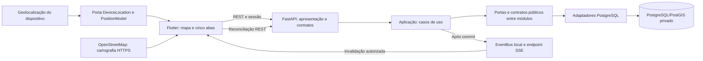

# Matriz de evidências — Arquitetura de Software

**Uni-FACEF — professor Carlos Alberto Lucas. Tema: Aplicativo de Mobilidade Urbana — Processamento em Tempo Real.** Protótipo NightPoint: descoberta de encontros automotivos por região; posição do dispositivo opcional, consulta geoespacial e atualização seletiva de detalhes. Funcionalidades parciais são identificadas, sem atribuir nota ou aceite ao próprio trabalho.

## Arquitetura materializada

O dispositivo não acessa tabelas de negócio. GPS atualiza estado local; a busca envia um centro à API. SSE é um stream HTTP que notifica alterações; o cliente relê REST. Consultas REST isoladas e reposicionamento do mapa não são apresentados como SSE. Não há garantia de tempo real rígido nem processamento distribuído.

## Atendimento aos critérios

| Critério do enunciado | Evidência verificável na implementação | Demonstração / limite |
|---|---|---|
| Coesão — 3,0 pontos | `backend/app/modules/identity`, `events`, `discovery`, `garage`, `community`; domínio/caso de uso/adaptador/apresentação agrupados por capacidade | Perfil cuida da identidade; eventos da gestão; descoberta da busca; garagem dos veículos; comunidade das interações. Não são apenas pastas: cada dono controla suas operações SQL. |
| Acoplamento e conascência — 3,0 pontos | Contratos `identity/api.py`, `events/api.py`, portas dos módulos, `backend/app/bootstrap.py`, repositories Flutter e seis exemplos abaixo | Dependências explícitas e inversão nos serviços. Compartilhar processo/banco/runtime ainda cria acoplamento operacional. |
| Arquitetura na solução — 3,0 pontos | `nightpoint/lib/app`, `core/api`, `features`; `backend/app/bootstrap.py`, `platform/database.py`, migrations, Compose e testes de fronteiras | Artefato executável, banco privado, contratos e testes reais; execução acadêmica deve ser conferida na própria cópia independente. Escalabilidade não comprovada por desenho. |

## Responsabilidades e comunicação

| Componente | Responsabilidade e dependência principal |
|---|---|
| Flutter `features/*/presentation` | Views/modelos de apresentação; chamadas por repositories, não SQL. |
| `core/api/api_client.dart` | Origem da API, sessão em memória, erros, prazo e cancelamento de requisições. |
| `core/location/device_location.dart`, `geolocator_location.dart`, `position_model.dart` | Porta do dispositivo, adaptação do plugin e ciclo de vida da posição; sem persistência ou cliente da API nesse modelo. |
| Identity | Identidade própria e perfil privado. A composição acadêmica usa personas sintéticas, nunca credenciais reais. |
| Events | Criação/gestão versionada, autoria/visibilidade e contrato público de acesso. |
| Discovery | Valida região/período e usa projeção autorizada de Eventos; PostGIS calcula distância. |
| Garage | Veículos privados 1:N, principal opcional único, arquivo/restauração e histórico. |
| Community | Reações/comentários; depende de `events.api.EventAccess`, sem importar adaptador SQL de Eventos. |
| Plataforma e composição | Configuração, banco/atestação, EventBus e injeção das implementações; lógica de produto permanece nos módulos. |

## Seis exemplos reais de conascência

As classificações seguintes são análise do código, não métricas automáticas nem citação literal do livro.

| Tipo / local | Dependência observada | Tratamento, motivo e impacto de mudança |
|---|---|---|
| **Nome (estática)** — `events/presentation.py` e `features/events/models/event_record.dart` | Produtor e consumidor JSON concordam em nomes como `starts_at` e `version`. | Mantida na fronteira REST, reduzida ao DTO/repository; mudança exige compatibilidade/snapshot/consumidor coordenados. Evita espalhar nomes HTTP em toda view. |
| **Tipo (estática)** — DTO `EventOutput.version`, domínio `Event.version` e `EventRecord.version` | Versão é inteiro; parsing e operações de edição dependem desse tipo. | Mantida e verificada por Pydantic/Dart/contrato; trocar para outro tipo exige migração do protocolo. Tipos explícitos tornam a quebra detectável. |
| **Significado/convenção (estática)** — `events/domain.py`, `events/infrastructure.py`, `event_editor.dart`, `event_detail_page.dart` | Valores `listed`/`owner_only` têm significado de visibilidade que produtor, política e UI precisam interpretar de modo consistente. | Mantida como convenção de contrato; autorização central no servidor reduz o grau da dependência. Novo valor exige regra/projeção/testes; a UI não concede acesso por convenção própria. |
| **Posição (estática)** — `DevicePoint(latitude, longitude)`, `GeolocatorLocation.current` e conversão para `LatLng` em `map_page.dart` | Dois argumentos double têm ordem semântica; invertê-los pode compilar e apontar região errada. | Mantida e localizada no adaptador/modelo de mapa; JSON da API usa campos nomeados. Testes de coordenadas limitam erro; parâmetros nomeados seriam evolução possível, sem refatoração ampla agora. |
| **Execução (dinâmica)** — `events/application.py` e `events/infrastructure.py` | Publicar invalidação deve ocorrer depois que o repositório retorna da transação concluída. | Mantida dentro do caso de uso: retorno após commit → publicação. Inverter a ordem permite notificação de dado não persistido; testes de commit/rollback exercitam esse contrato. |
| **Temporal (dinâmica / corrida)** — `garage/infrastructure.py` e migration 0007 | Duas transações escolhendo principal simultaneamente podem disputar o mesmo estado do dono. | Risco reduzido com advisory lock transacional do dono e índice único parcial. Forte dependência temporal fica confinada à persistência; mudar isolamento/lock exige repetir teste de concorrência. Não se confunde com a expressão “tempo real” do tema. |

Aplicação do princípio de força, localidade e grau: tornar dependências visíveis, manter regras fortes perto de seus donos e expor contratos menores entre módulos. Eliminar todo acoplamento não é objetivo; seria incompatível com componentes que cooperam.

## Decisões e trade-offs

| Decisão implementada | Benefício e custo assumido |
|---|---|
| Monólito modular | Menos implantação/operação para o protótipo; fronteiras lógicas continuam testadas. Escala por processo e banco compartilhado; não é microsserviço. |
| Camadas e portas seletivas | Domínio/casos de uso separados de HTTP/SQL, DI na composição; aumenta quantidade de interfaces/arquivos onde há integração real. Não foram criadas portas sem consumidor. |
| Flutter separado da API | UI multiplataforma e autorização central; depende de contrato/versionamento/rede. |
| PostgreSQL/PostGIS | Transações, integridade e distância geográfica na persistência; dependência técnica de SQL/PostGIS e operação do banco. |
| REST | Operações explícitas, DTOs, versões e idempotência; leitura extra para reconciliar eventos SSE. |
| SSE seletivo | Canal servidor→cliente com reconexão e reconsulta; EventBus em memória é local a um processo, sem entrega distribuída ou latência rígida garantida. |
| GPS e tiles externos | Capacidade do dispositivo e cartografia real; dependem de permissão, Internet e disponibilidade. Alternativa manual permanece. Sem trajetórias armazenadas. |

## Evidências e limites para o documento final

Fontes técnicas: `backend/tests/test_architecture.py`, testes de Eventos/reatividade/Garagem/Comunidade, `nightpoint/test/map_model_test.dart` e `position_model_test.dart`, OpenAPI em `contracts`, script de demonstração SSE e registros de execução da entrega. Referenciar o relatório acadêmico final para resultados efetivos; testes antigos não se tornam nova execução. Desempenho, produção, provedores de identidade reais e validação Android permanecem fora do aceite. Documento PDF/Word final é preparado/conferido separadamente, conforme autorização.

Referência: RICHARDS, Mark; FORD, Neal. *Fundamentos da Arquitetura de Software*. Edição em português utilizada na disciplina, especialmente modularidade, coesão, acoplamento e conascência. Os dados de edição e paginação devem seguir o exemplar utilizado no trabalho acadêmico; não foram identificados neste pacote. Consulta complementar ao original em inglês: [capítulo sobre modularidade da editora O’Reilly](https://www.oreilly.com/library/view/fundamentals-of-software/9781492043447/ch03.html). Taxonomia complementar: [connascence.io](https://connascence.io/). As tabelas de aplicação são análise original deste protótipo; não reproduzem trechos do livro.
